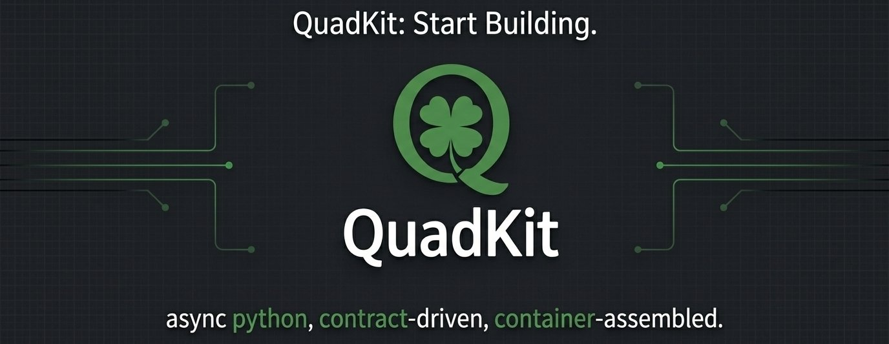

# quadkit



*async python, contract-driven, container-assembled.*

[](https://pypi.org/project/quadkit/)
[](https://pypi.org/project/quadkit/)
[](https://github.com/dbtinoy-/quadkit/blob/main/LICENSE)
[](https://github.com/dbtinoy-/quadkit/actions/workflows/public-validation.yml)
[](https://dbtinoy-.github.io/quadkit/)
[](https://codespaces.new/dbtinoy-/quadkit)

Stop assembling. Start building.

Every backend starts the same way: you wire up routing, validation,
lifecycle, and dependency graphs before you write a single line of real
code. Quadkit gives you a ready-to-use foundation — you define providers,
modules, and controllers, and one container boots them in the right order.

- **One-call startup.** Providers, modules, controllers — assembled and
  booted in dependency order, automatically.
- **Contracts, not dependencies.** Every package talks through protocols,
  so implementations change without breaking callers.
- **Results, not surprises.** Expected failures are `Ok`/`Err` values the
  type checker sees; controllers return them and the web layer renders
  honest RFC 7807 problem responses.
- **Swappable by config.** Bind a different implementation to the same
  contract with one line; nothing downstream changes.
- **Async end to end.** Container, modules, and controllers are
  concurrency-safe by design.

## install

```bash
uv add "quadkit[web]"      # core + web + server (what the example uses)
pip install "quadkit[web]"
```

## 60 seconds, end to end

```python
from quadkit import Application
from quadkit.web import Controller, get, WebModule
from quadkit.web.server import run_server


class HelloController(Controller):
    @get("/hello")
    async def hello(self, name: str = "world") -> dict:
        return {"message": f"hello, {name}"}


app = Application()
app.add_modules([WebModule.configure(controllers=[HelloController])])

run_server(app, port=8000)
```

→ http://localhost:8000/hello?name=quadkit

Also available by default:

- → http://localhost:8000/health — liveness probe
- → http://localhost:8000/docs — generated OpenAPI docs (Swagger UI;
  `/redoc` and `/openapi.json` too)

## why quadkit?

Quadkit is a kit of **13 published packages**, installed à la carte: eleven
to build with, one optional to test, one for the command line.


| package | what it is |
| --- | --- |
| [`quadkit-contracts`](https://pypi.org/project/quadkit-contracts/) | protocol definitions every package binds against — and the `Result` error model, with zero runtime dependencies |
| [`quadkit`](https://pypi.org/project/quadkit/) | the framework core — DI container, modules, typed config, logging, domain primitives |
| [`quadkit-web`](https://pypi.org/project/quadkit-web/) | ASGI layer — controllers, routing, middleware, OpenAPI docs, websockets |
| [`quadkit-sql`](https://pypi.org/project/quadkit-sql/) | repositories, units of work and migrations, declared as protocols so the backend stays yours |
| [`quadkit-cache`](https://pypi.org/project/quadkit-cache/) | cache protocols and the memory/Redis backends behind them |
| [`quadkit-auth`](https://pypi.org/project/quadkit-auth/) | JWT issuance, user storage and permission evaluation |
| [`quadkit-events`](https://pypi.org/project/quadkit-events/) | an in-process event bus with typed handlers |
| [`quadkit-tasks`](https://pypi.org/project/quadkit-tasks/) | background jobs and scheduled work |
| [`quadkit-storage`](https://pypi.org/project/quadkit-storage/) | object storage behind a filesystem/S3 protocol |
| [`quadkit-http`](https://pypi.org/project/quadkit-http/) | typed HTTP clients for talking to other services |
| [`quadkit-monitor`](https://pypi.org/project/quadkit-monitor/) | metrics, tracing and health endpoints |
| [`quadkit-cli`](https://pypi.org/project/quadkit-cli/) | project scaffolding and code generators |

Every one of them binds against the same protocol layer, so the contracts
define interfaces for SQL, cache, auth, events, tasks, queues, LLM, RAG, and
more. You can install a package and swap its implementation without touching
the call sites — that is the point of the protocol split.

## testing

[`quadkit-testing`](https://pypi.org/project/quadkit-testing/) provides
test harnesses, fakes, and fixtures for use at test-time only.

```bash
uv add --dev quadkit-testing
```

Boot the real application in-process and assert on responses — no
listening socket, no mocking:

```python
import pytest

from quadkit.testing import WebTestBed

from my_api.app import create_app


@pytest.mark.asyncio
async def test_hello() -> None:
    async with WebTestBed(create_app()) as bed:
        response = bed.get("/hello", params={"name": "quadkit"})
        response.assert_status(200)
        assert response.json == {"message": "hello, quadkit"}
```

Swap implementations at the binding, not the import site
(`overrides={UserRepository: FakeRepo()}`), or work at the DI level
with `QuadkitContainerHarness()` — a container with the common fakes
pre-registered. A pytest plugin auto-registers fixtures (`fake_clock`,
`fake_event_bus`, `fake_logger`, and friends) — no `conftest.py` wiring.

Run the full test suite:

```bash
uv run pytest
```

## 5-minute feature tour

Forty-two runnable showcases — one feature per file, each an executable test
green against the published wheels. Everything needed is in this repository:

```bash
pip install quadkit quadkit-web quadkit-testing
pytest docs/guides/examples/features/
```

Highlights: [the Result pattern](docs/guides/examples/features/test_feature_result.py)
with [domain errors mapped to HTTP](docs/guides/examples/features/test_feature_result_web.py),
[SSE feeds](docs/guides/examples/features/test_feature_sse.py),
[declarative rate limiting](docs/guides/examples/features/test_feature_throttle.py),
and [versioned APIs with sunset headers](docs/guides/examples/features/test_feature_api_version.py).
See the [tour README](docs/guides/examples/features/README.md) for the full list.

## architecture

Three rules hold the system together:

1. **Contracts are the only cross-package surface.** A package depends on
   `quadkit-contracts`, never on a sibling implementation.
2. **Composition happens at the edge.** Modules declare what they provide;
   the container resolves the graph once, at boot.
3. **Configuration is data.** Every setting has a code default, so an
   unset variable is always valid.

Configuration binds from the environment with the `QK_` prefix, nested by
double underscore:

```bash
QK_QUADKIT__LOGGING__LEVEL=DEBUG
QK_WEB__SECURITY__CSRF__SECRET_KEY=...
```

## from source

No setup at all: open the repository in
[Codespaces](https://codespaces.new/dbtinoy-/quadkit) — the included
devcontainer installs the locked workspace automatically.

Or locally:

```bash
git clone https://github.com/dbtinoy-/quadkit.git
cd quadkit

uv sync --locked

# the offline gate: plain pytest deselects integration-marked tests, so it
# needs zero external services on a fresh clone
uv run pytest
```

## contributing

Pull requests are welcome. Two things worth knowing before you open one
(see [SUPPORT.md](./SUPPORT.md) for where to ask questions and
[CHANGELOG.md](./CHANGELOG.md) for what changed recently):

- **Sign your commits** (`git commit -s`). There is no CLA — Apache-2.0
  §5 already covers inbound contributions.
- **This repository is generated.** Quadkit is developed in a private
  workspace and exported here each release, so merges are replayed
  upstream rather than merged in place. Your commit and authorship are
  preserved, and your PR is closed with a link to the release that
  contains it — closure is not rejection.

See [CONTRIBUTING.md](./CONTRIBUTING.md) for the full process.

## license

Apache-2.0 — see [LICENSE](./LICENSE).

"Quadkit" and the Quadkit logo are trademarks of the project and are not
covered by the code license — see [TRADEMARK.md](./TRADEMARK.md).
