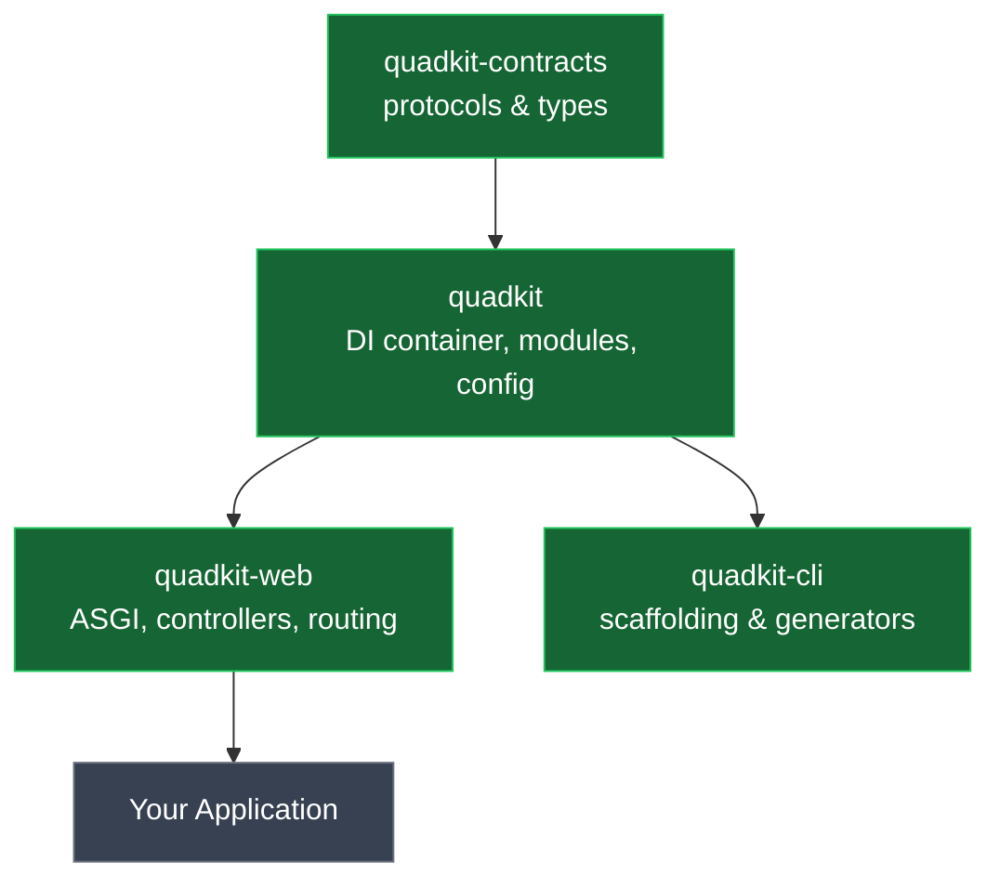

# quadkit


*async python, contract-driven, container-assembled.*

[](https://pypi.org/project/quadkit/)
[](https://pypi.org/project/quadkit/)
[](https://github.com/dbtinoy-/quadkit/blob/main/LICENSE)

Stop assembling. Start building.

Every backend starts the same way: you wire up routing, validation,
lifecycle, and dependency graphs before you write a single line of real
code. Quadkit gives you a ready-to-use foundation — you define providers,
modules, and controllers, and one container boots them in the right order.

- **One-call startup.** Providers, modules, controllers — assembled and
  booted in dependency order, automatically.
- **Contracts, not dependencies.** Every package talks through protocols,
  so implementations change without breaking callers.
- **Swappable by config.** Bind a different implementation to the same
  contract with one line; nothing downstream changes.
- **Async end to end.** Container, modules, and controllers are
  concurrency-safe by design.

## install

```bash
uv add "quadkit[web]"      # core + web + server (what the example uses)
pip install "quadkit[web]"
```

## 60 seconds, end to end

```python
from quadkit import Application
from quadkit.web import Controller, get, WebModule
from quadkit.web.server import run_server


class HelloController(Controller):
    @get("/hello")
    async def hello(self, name: str = "world") -> dict:
        return {"message": f"hello, {name}"}


app = Application()
app.add_modules([WebModule.configure(controllers=[HelloController])])

run_server(app, port=8000)
```

→ http://localhost:8000/hello?name=quadkit

Also available by default:

- → http://localhost:8000/health

## why quadkit?

QuadKit is built on **4 core packages** — a kit of four.



| package | what it is |
| --- | --- |
| [`quadkit-contracts`](https://pypi.org/project/quadkit-contracts/) | protocol definitions every package binds against |
| [`quadkit`](https://pypi.org/project/quadkit/) | the framework core — DI container, modules, config, logging, domain primitives |
| [`quadkit-web`](https://pypi.org/project/quadkit-web/) | ASGI layer — controllers, routing, middleware, websockets |
| [`quadkit-cli`](https://pypi.org/project/quadkit-cli/) | project scaffolding and code generators |

The contracts define interfaces for SQL, cache, auth, events, tasks,
queues, LLM, RAG, and more — all built against the same protocol layer.

## testing

[`quadkit-testing`](https://pypi.org/project/quadkit-testing/) provides
test harness, fakes, and compliance suites for use at test-time only.

```bash
uv add --dev quadkit-testing
```

```python
import pytest
from quadkit.testing import QuadkitContainerHarness


@pytest.fixture
def harness():
    return QuadkitContainerHarness()


async def test_my_service(harness):
    result = await harness.resolve(MyService)
    assert result is not None
```

Run the full test suite:

```bash
uv run pytest
```

## architecture

Three rules hold the system together:

1. **Contracts are the only cross-package surface.** A package depends on
   `quadkit-contracts`, never on a sibling implementation.
2. **Composition happens at the edge.** Modules declare what they provide;
   the container resolves the graph once, at boot.
3. **Configuration is data.** Every setting has a code default, so an
   unset variable is always valid.

Configuration binds from the environment with the `QK_` prefix, nested by
double underscore:

```bash
QK_QUADKIT__LOGGING__LEVEL=DEBUG
QK_WEB__SECURITY__CSRF__SECRET_KEY=...
```

## from source

```bash
git clone https://github.com/dbtinoy-/quadkit.git
cd quadkit

uv sync --locked

# the offline gate: plain pytest deselects integration-marked tests, so it
# needs zero external services on a fresh clone
uv run pytest
```

## contributing

Pull requests are welcome. Two things worth knowing before you open one:

- **Sign your commits** (`git commit -s`). There is no CLA — Apache-2.0
  §5 already covers inbound contributions.
- **This repository is generated.** Quadkit is developed in a private
  workspace and exported here each release, so merges are replayed
  upstream rather than merged in place. Your commit and authorship are
  preserved, and your PR is closed with a link to the release that
  contains it — closure is not rejection.

See [CONTRIBUTING.md](./CONTRIBUTING.md) for the full process.

## license

Apache-2.0 — see [LICENSE](./LICENSE).

"Quadkit" and the Quadkit logo are trademarks of the project and are not
covered by the code license — see [TRADEMARK.md](./TRADEMARK.md).
