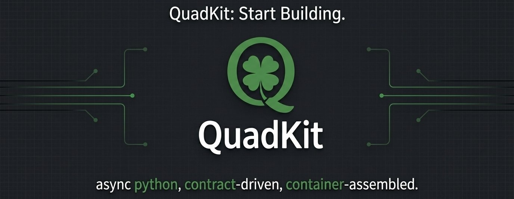

# quadkit-cli



[](https://pypi.org/project/quadkit-cli/)
[](https://pypi.org/project/quadkit-cli/)
[](https://github.com/dbtinoy-/quadkit/blob/main/LICENSE)

The `quadkit` command line: project scaffolding, generators, a smart
runner, and administrative commands for every stage of the application
lifecycle. Contributor-based — other packages can register their own
commands.

For day-to-day Quadkit developers: scaffold, generate, run, inspect.

## The quadkit family

| Package | Role |
| --- | --- |
| [`quadkit-contracts`](https://pypi.org/project/quadkit-contracts/) | zero-dependency protocols, types, exception hierarchy |
| [`quadkit`](https://pypi.org/project/quadkit/) | the framework core — DI container, modules, config, logging, `Result` |
| [`quadkit-web`](https://pypi.org/project/quadkit-web/) | ASGI layer — controllers, routing, middleware, OpenAPI docs |
| [`quadkit-cli`](https://pypi.org/project/quadkit-cli/) | project scaffolding and code generators |
| [`quadkit-testing`](https://pypi.org/project/quadkit-testing/) | in-process test beds, fakes, fixtures |

## Installation

```bash
uv add quadkit-cli
# or as a standalone tool:
uv tool install quadkit-cli
```

Requires **Python >= 3.11**.

## Explicit runtime health (local 0.0.50 source)

```bash
# File checks only; explicitly reports that runtime health was NOT run
quadkit system health

# From an installed/importable app project, opt into real provider lifecycle
quadkit system health --app my_api.app:app --check sql:database_connection --strict
# Repeat --check contributor:name to select additional canonical async probes
```

`--app` must identify a fresh Quadkit `Application` **instance** in CREATED state,
not an ASGI object or a factory. The command starts it, awaits selected async
`check(container) -> HealthCheckResult` contributions, and stops it in `finally`,
including failures/cancellation. Startup/shutdown each have a cooperative 60-second
limit; probes use their contribution timeout. Unknown/duplicate/ambiguous selections
are rejected before application import/boot. Only explicitly selected checks run;
installed packages do not imply configured application dependencies.

**Booting has real side effects:** normal providers/background tasks and any
application-configured migrations may run. Use an approved environment. This is
not a read-only sandbox; it does not replace provider/configuration authority,
start an HTTP server, register custom generated probes or verify migrations itself.

Only canonical HEALTHY is a passing probe. All other states/errors/malformed
results fail critical checks and warn for non-critical checks; `--strict` fails on
warnings too. Boot/shutdown failures fail the command. Provider message/error text
is not echoed by the runner (application/provider logs retain their own policies).
Without explicit runtime options the file-only command prints a runtime-not-run
warning; strict file-only mode therefore cannot claim runtime acceptance.

The SQL callback is demonstrated with generated anonymous-action apps in flat and
modular layouts using local SQLite. Other contributed probes still need individual
contract/runtime evidence; this is not universal dependency or installed-wheel
acceptance. No `quadkit health` top-level alias is introduced: use **system health**.

## Minimal working example

There is no code to write — the product is the command line:

```bash
# Create a new project (single `api` template); the package
# inside is my_api/ with app.py exposing create_app()
quadkit new project my-api
cd my-api

# Generate application code (list all generators: quadkit gen list)
quadkit gen provider MyProvider
quadkit gen controller Orders

# Serve the application; reload is on by default, pass --no-reload in prod
quadkit run my_api.app:create_app --host 0.0.0.0 --port 8000 --workers 4
```

Eleven generators ship today (`quadkit gen list`):

```text
controller  middleware  graphql  webhook  websocket  exception_filter
interceptor  error  resource  provider  test
```

Global options: `--json` for machine-readable output, `--quiet`,
`--debug`, `--no-color`, and `--config <path>` to point at a specific
`application.yaml`.

## Command index

| Command | Purpose |
| --- | --- |
| `quadkit new project / module / package` | scaffold projects, bounded contexts, and `quadkit-*` extensions |
| `quadkit init` | initialize Quadkit in an existing project |
| `quadkit add <provider>` | add a provider to a project (e.g. `database`, `auth`) |
| `quadkit run [target]` | smart runner — auto-detects `create_app`, sets profile |
| `quadkit dev start` | production-server startup |
| `quadkit gen <what>` | code generation (controllers, providers, middleware, tests, more — see `quadkit gen list`) |
| `quadkit test` / `quadkit lint` | project-level checks |
| `quadkit db` / `quadkit events` | database / event-schema management |
| `quadkit config` / `quadkit inspect` / `quadkit shell` | configuration, runtime introspection, REPL |
| `quadkit project` / `quadkit contrib` / `quadkit system` | project tasks, contributors, system info |
| `quadkit version` | framework and package versions |

Per-distribution guide:
[quadkit-cli reference](https://oridecon.dev/quadkit/reference/cli/).

## Optional extras

`[dev]` and `[test]` bundle tooling; `[all]` pulls everything.

## Configuration

The CLI reads `application.yaml` like any Quadkit application; its own
section is `cli` (`color`), overridable via `QK_CLI__*`, e.g.
`QK_CLI__COLOR=false`.

## Error handling

Commands report structured failures (use `--json` for machine-readable
envelopes) and non-zero exit codes; `--debug` surfaces full tracebacks.

## Testing

`quadkit test` runs the project suite; the CLI's own behavior is
covered by the public test set the release pipeline executes from the
exported tree.

## Security

The CLI reads configuration and scaffolds code — it does not serve
traffic. As with every distribution, keep the `0.x` line pinned and
review release notes on upgrade. Report vulnerabilities privately per
[SECURITY.md](https://github.com/dbtinoy-/quadkit/blob/main/SECURITY.md).

## Stability

Version `0.0.50` in the `0.x` series, versioned independently of the
other distributions; APIs may change between minor versions until
1.0 — pin an exact version (`quadkit-cli==0.0.50`) or a tight range
(`>=0.0.50,<0.1.0`). Full policy:
[stability and compatibility](https://oridecon.dev/quadkit/ecosystem/compatibility/).

## Links

- **Documentation** — <https://oridecon.dev/quadkit/>
- **Getting started** — <https://oridecon.dev/quadkit/getting-started/installation/>
- **Changelog** — <https://github.com/dbtinoy-/quadkit/blob/main/CHANGELOG.md>
- **Issues** — <https://github.com/dbtinoy-/quadkit/issues>
- **Security** — report privately per [SECURITY.md](https://github.com/dbtinoy-/quadkit/blob/main/SECURITY.md)
- **Contributing** — [CONTRIBUTING.md](https://github.com/dbtinoy-/quadkit/blob/main/CONTRIBUTING.md)

Apache-2.0 — see [LICENSE](https://github.com/dbtinoy-/quadkit/blob/main/LICENSE). "Quadkit" and the
Quadkit logo are trademarks of the project — see
[TRADEMARK.md](https://github.com/dbtinoy-/quadkit/blob/main/TRADEMARK.md).
