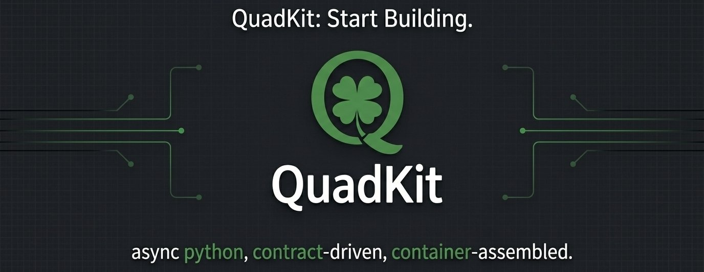

# quadkit-web



[](https://pypi.org/project/quadkit-web/)
[](https://pypi.org/project/quadkit-web/)
[](https://github.com/dbtinoy-/quadkit/blob/main/LICENSE)

The async web layer for Quadkit: controllers with signature-based
binding, a `Result`-to-HTTP bridge, middleware pipelines, and generated
OpenAPI docs — built on Starlette, server-backend agnostic.

For application developers building HTTP services: define controllers,
attach the web module, and serve on Granian, Uvicorn, or Hypercorn.

## The quadkit family

| Package | Role |
| --- | --- |
| [`quadkit-contracts`](https://pypi.org/project/quadkit-contracts/) | zero-dependency protocols, types, exception hierarchy |
| [`quadkit`](https://pypi.org/project/quadkit/) | the framework core — DI container, modules, config, logging, `Result` |
| [`quadkit-web`](https://pypi.org/project/quadkit-web/) | ASGI layer — controllers, routing, middleware, OpenAPI docs |
| [`quadkit-cli`](https://pypi.org/project/quadkit-cli/) | project scaffolding and code generators |
| [`quadkit-testing`](https://pypi.org/project/quadkit-testing/) | in-process test beds, fakes, fixtures |

## Installation

The distribution ships no server by itself — install one backend (or
use `quadkit[web]`, which resolves to `quadkit-web[granian]`):

```bash
uv add "quadkit-web[granian]"   # default backend, ASGI
uv add "quadkit-web[uvicorn]"   # alternative backend
uv add "quadkit-web[hypercorn]" # alternative backend
```

Requires **Python >= 3.11**.

## Minimal working example

```python
from quadkit import Application
from quadkit.web import Controller, WebModule, get
from quadkit.web.server import run_server


class HelloController(Controller):
    @get("/hello")
    async def hello(self, name: str = "world") -> dict:
        return {"message": f"hello, {name}"}


def create_app() -> Application:
    app = Application()
    app.add_modules([WebModule.configure(controllers=[HelloController])])
    return app


if __name__ == "__main__":
    run_server(create_app(), port=8000)
```

`/hello` is yours; `/docs`, `/redoc`, `/openapi.json`, and `/health`
come with it. Full walkthrough:
[your first app](https://oridecon.dev/quadkit/getting-started/first-app/), then the
[web API guide](https://oridecon.dev/quadkit/packages/web/quadkit-web/docs/guide/).

## Binding, not parsing

Handler signatures *are* the validation: `query()`, `path()`, `header()`,
`cookie()`, `form()`, and `body()` bind and convert request data to typed
values — a `DomainModel`-annotated parameter validates the whole JSON
body, and a malformed request is a `422` with per-field errors before
your code runs:

```python
from dataclasses import dataclass

from quadkit.domain import DomainModel
from quadkit.web import Controller, body, get, post, query


@dataclass
class CreateOrder(DomainModel):
    sku: str
    qty: int = 1


class OrdersController(Controller):
    @get("/orders")
    async def list_orders(self, page: int = query(1)) -> dict:
        return {"page": page}  # query param, converted to int

    @post("/orders")
    async def create_order(self, order: CreateOrder = body()) -> dict:
        return {"sku": order.sku, "qty": order.qty}  # validated body
```

Controllers can also be discovered by package instead of listed —
`WebModule.configure(discover=["my_app.controllers"])`. One security
note: cookie-based CSRF is on by default, so JSON clients send the
`X-CSRF-Token` header (or you disable CSRF for token-authenticated
APIs: `web.security.enable_csrf: false`). More composition —
middleware, guards, per-route rate limits — in the
[web API guide](https://oridecon.dev/quadkit/packages/web/quadkit-web/docs/guide/) and the
[feature tour](https://github.com/dbtinoy-/quadkit/blob/main/docs/guides/examples/features/README.md).

## Optional extras

| Extra | Contents |
| --- | --- |
| `[granian]` / `[uvicorn]` / `[hypercorn]` | ASGI server backends |
| `[security]` | `itsdangerous` — signed tokens |
| `[templates]` | Jinja2 template rendering |
| `[websocket]` | `websockets` — WebSocket support |
| `[client]` | HTTP client |
| `[test]` / `[docs]` / `[dev]` / `[all]` | tooling bundles |

## Public API entry points

```python
from quadkit.web import (
    Controller,
    WebModule,
    get,
    post,
    put,
    patch,
    delete,
    body,
    query,
    path,
    header,
    cookie,
    form,
    HTTPError,
    error_status,
    JSONResponse,
    HTMLResponse,
    StreamingResponse,
    FileResponse,
    RedirectResponse,
    BackgroundTasks,
)
from quadkit.web.config import WebConfig, ServerConfig, RateLimitConfig
from quadkit.web.middleware import MiddlewareRegistry
from quadkit.web.server import run_server, run_server_async
```

`WebModule.configure(controllers=..., middleware=...)` is the assembly
point; `WebModule.stub()` gives a no-op web module for unit tests.

## OpenAPI model schemas

Route metadata may declare `request_model=InputModel` and
`response_model=OutputModel`. For Pydantic models, native documentation batches
schema generation so nested/recursive references resolve under components and
same-named models from different modules do not overwrite each other. Requests
use validation schemas; responses (including list items) use serialization
schemas, respecting fields excluded by model serialization. Conflicts with an
already registered, different component fail rather than silently replacing it.

This metadata documents the declared models: it does not validate or redact an
arbitrary returned dict, install authentication, or replace explicit handler
validation. The non-Pydantic DomainModel schema protocol retains its existing
behavior; its arbitrary nested definitions are not covered by this guarantee.

## Configuration

Everything is typed, validated at boot, and env-overridable
(`QK_WEB__...`):

| YAML path | Default | What it controls |
| --- | --- | --- |
| `web.server.host` / `port` | `0.0.0.0` / `8000` | bind address |
| `web.server.backend` | `granian` | `granian`, `uvicorn`, or `hypercorn` |
| `web.server.workers` | `1` | worker processes (production lever) |
| `web.server.reload` | `false` | hot reload (development aid) |
| `web.security.enable_csrf` | `true` | cookie-based CSRF protection |
| `web.security.cors.allowed_origins` | `[]` (deny-by-default) | CORS allow-list |
| `web.rate_limit.enabled` | `false` | opt-in rate limiting |
| `web.api_docs.enabled` | unset → on outside production | `/docs`, `/redoc` + `/openapi.json` |
| `web.max_body_size` | 10 MiB | request body cap |

Env overrides mirror the YAML path, e.g. `QK_WEB__SERVER__PORT=8080`,
`QK_WEB__SECURITY__CORS__ALLOWED_ORIGINS='["https://app.example.com"]'`.
See [configuration](https://oridecon.dev/quadkit/getting-started/configuration/).

## Error handling

Every failure renders as an RFC 7807 problem body: domain exceptions map
through a status table, `HTTPError` gives direct control, request-body
validation answers `422` with per-field errors.
[The error-handling guide](https://oridecon.dev/quadkit/fundamentals/result-pattern/) shows
all three paths with executable examples.

## Testing

`quadkit-testing`'s `WebTestBed` boots your app in-process and asserts
on responses — no listening socket, no mocking:

```python
async def test_hello() -> None:
    from quadkit.testing import WebTestBed

    async with WebTestBed(create_app()) as bed:
        response = bed.get("/hello", params={"name": "quadkit"})
        response.assert_status(200)
        assert response.json == {"message": "hello, quadkit"}
```

## Security

Conservative defaults: CSRF on, CORS deny-by-default, unexpected
exceptions contained to a minimal 500 body. Details and hardening:
[secure configuration](https://oridecon.dev/quadkit/getting-started/configuration/);
report vulnerabilities privately per [SECURITY.md](https://github.com/dbtinoy-/quadkit/blob/main/SECURITY.md).

## Declared Result error documentation

Route decorators accept `result_errors=[NotFoundError, ValidationError]`. These
explicit declarations document default **Result-return** errors as
`application/problem+json`, using the same status registry as
`ResultResponseMapper`; registered remaps are reflected in generated OpenAPI.
The success response is retained when additional responses are supplied.
Native CRUD scaffolds declare the error arms they already return and check
`OpenAPIGenerator.supports_result_error_docs_v1` at import time, rather than
silently losing their documentation with an older Web implementation.

This is documentation, not response validation or new runtime behavior. It does
not infer authorization, guard/binder errors, thrown exceptions or arbitrary
instance-specific status overrides. Custom error renderers require explicit
`responses` at the mapped status; dynamic status descriptors require an explicit
`openapi_operation`. A supplied full operation remains authoritative. Finish
mapping registration before generating/serving documentation, as with runtime
startup wiring. Arbitrary returned dictionaries and list envelopes are not
thereby validated or redacted.

## Stability

Version `0.0.50` in the `0.x` series, versioned independently of the
other distributions; APIs may change between minor versions until
1.0 — pin an exact version (`quadkit-web==0.0.50`) or a tight range
(`>=0.0.50,<0.1.0`). Full policy:
[stability and compatibility](https://oridecon.dev/quadkit/ecosystem/compatibility/).

## Links

- **Documentation** — <https://oridecon.dev/quadkit/>
- **Getting started** — <https://oridecon.dev/quadkit/getting-started/installation/>
- **Changelog** — <https://github.com/dbtinoy-/quadkit/blob/main/CHANGELOG.md>
- **Issues** — <https://github.com/dbtinoy-/quadkit/issues>
- **Security** — report privately per [SECURITY.md](https://github.com/dbtinoy-/quadkit/blob/main/SECURITY.md)
- **Contributing** — [CONTRIBUTING.md](https://github.com/dbtinoy-/quadkit/blob/main/CONTRIBUTING.md)

Apache-2.0 — see [LICENSE](https://github.com/dbtinoy-/quadkit/blob/main/LICENSE). "Quadkit" and the
Quadkit logo are trademarks of the project — see
[TRADEMARK.md](https://github.com/dbtinoy-/quadkit/blob/main/TRADEMARK.md).

### Documentation-only response models

`@get(..., response_schema_model=Model)` publishes a Pydantic serialization
schema without selecting runtime ObjectMapper mapping, validation or redaction.
The value must be a Pydantic model class when active. It is a fallback: an
explicit `response_model`, explicit success `responses` content or final
`openapi_operation` remains authoritative. Use enforced contracts/validation when
response shaping is required; never treat this metadata as a security boundary.
`OpenAPIGenerator.supports_response_schema_model_v1 is True` is the native
capability marker expected by current generated controllers.

### Declared datetime SQL row responses

When native controller generation receives declared `datetime` fields through
`FieldSpec` / `EntitySpec`, create/get/list/update serialize those fields through
`quadkit.web.responses.sql.serialize_sql_row`. It restores native SQL naive UTC
and normalizes offset-bearing timestamps to explicit UTC (`+00:00`). Arbitrary
strings and nested JSON are not interpreted as dates. Missing/null fields remain
unchanged; this is not entity validation or redaction. Malformed stored datetime
values raise `SerializationError` (server-side 500), not request-validation 422.
SQL storage, request DTO validation and implicit metadata field policy are not
changed. Existing standalone applications need explicit regeneration/adoption.

The native CRUD template documents entity create/get/update, the concrete
`CrudCollectionResponse[Entity]` items/limit envelope (not Page pagination), and
`CrudDeleteResponse` message acknowledgement. These classes live in
`quadkit.web.docs.response_models`; they are schema declarations, not runtime
controller wrappers or serializers. Custom repositories/serializers must supply
and verify their own truthful documentation.

### Explicit default validation-filter documentation

`ValidationErrorFilter.default_documented_responses()` returns fresh 422
`application/problem+json` metadata from the native ProblemDetail schema. Generated
CRUD list routes opt in through normal `responses=` metadata for typed query
binding. This documents the **default** filter only: replacing local/global filters
requires declaring the replacement's own status/body contract. The helper never
executes filters or infers outcomes from handler signatures. Existing response and
explicit-operation overrides remain authoritative. Generated list modules check the
strict `supports_default_validation_docs_v1` capability; get-only modules do not
acquire the filter-documentation dependency. Runtime binding/filter order and body
rendering are unchanged.

### Producer-owned guard rejection documentation

Bearer metadata may contain immutable Contracts `HttpErrorMessageDocumentation`
values committing to a JSON error/message envelope. Web validates and describes
those explicit claims without importing Auth or inferring guard behavior. Complete
explicit operations and explicit per-status responses remain authoritative.
Automatically documented outcomes sharing a status retain their distinct media
schemas; same-media schemas compose as alternatives while preserving deferred model
references. Malformed or duplicate rejection declarations fail documentation
construction. No authentication/filter execution or policy changes result from the
metadata. This does not infer401 middleware bodies or arbitrary custom guards.


Generators may share the pure
`quadkit.web.docs.security.documented_guard_rejections(metadata)` renderer with
served documentation. It validates the producer declaration and returns fresh
response dictionaries without guard execution or Auth imports. Response precedence
and schema composition remain the responsibility of the consuming document builder.


### Native authentication middleware rejection documentation

`AuthIntegration.configure` returns native `AuthenticationMiddlewareDocumentation`
only after installing authentication with usable authenticators and completing
role-guard setup. WebProvider passes that context to served OpenAPI; callers not
using the integration may explicitly supply the native context via
`OpenAPIGenerator(..., authentication_middleware=...)` only when the native
middleware is actually installed with authenticators. Empty-authenticator pass-through
or arbitrary/custom middleware must not publish that claim.

The immutable context snapshots literal prefix exclusions and describes only the
native error-only401 JSON branch. It never guesses bearer/cookie credentials or
guard-specific responses. Explicit operation/status responses stay authoritative;
automatic same-status outcomes compose without losing distinct media or pending
model-schema references. The metadata does not execute authenticators or alter
runtime policy. Static generated401 composition is a separate application concern.


For templated documentation paths, an exclusion suppresses401 only when it covers
the fixed leading text before the first parameter. Prefixes reaching parameter
values can exempt some requests while others still reject401; brace-delimited
variable names are never treated as runtime exemption values. The actual middleware
continues literal prefix matching on concrete request paths, unchanged.
